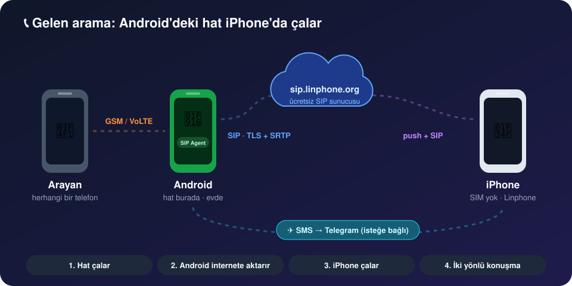
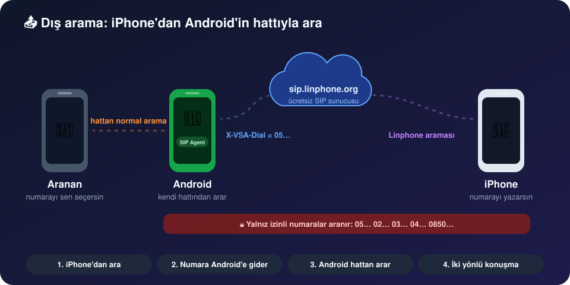

# iPhone Hat Köprüsü

**Android telefondaki Türk hattına gelen aramaları SIM'siz bir iPhone'da çaldırın, cevaplayın ve iPhone'dan o hatla arama yapın.** Root yok, kablo yok, ücretli servis yok. SMS'ler ve cevapsız aramalar da Telegram'a düşer.

*Ring a SIM-less iPhone for calls to a SIM in an Android phone, answer them, and place calls through that SIM. No root, no cable, no paid service. [English below](#english).*

[](https://github.com/mustafayusufaksoy/iphone-hat-koprusu/actions/workflows/test.yml)
[](LICENSE)


<p align="center">
  
</p>

## 🤔 Sorun

Yurt dışından getirilen ve IMEI kaydı yapılmamış bir iPhone'a Türk hattı takılınca hat kısa sürede engelleniyor. Hat ikinci bir Android telefonda duruyor, ama iki telefonla gezmek istemiyorsunuz: elinizde hep iPhone var, aramalar Android'e geliyor.

Bu repo, Android'deki hattı internet üzerinden iPhone'a taşıyan bir kurulumun tarifi ve bakım betikleri. Hat, kayıtlı Android telefonda kalır; IMEI kaydı atlatılmaz.

## ✅ Ne çalışıyor

Gerçek bir kurulumda (TECNO SPARK 8C, Android 12, MediaTek, Turkcell) Kasım 2026'da test edildi:

| Özellik | Durum |
|---|---|
| Hatta gelen arama iPhone'da çalar, iki yönlü konuşulur | ✅ çalışıyor |
| iPhone'da Linphone kapalıyken / kilitliyken çalması (push) | ✅ çalışıyor |
| Android Wi-Fi'da ya da yalnız mobil veride | ✅ ikisi de |
| iPhone'dan Android hattıyla dışarı arama | ✅ numara aranıyor (ses henüz tam doğrulanmadı) |
| SMS ve cevapsız aramalar Telegram'a | ✅ çalışıyor |
| iPhone'dan Android hattıyla SMS göndermek | ❌ yok |
| Android yeniden başlayınca kendiliğinden toparlanma | ❌ Shizuku elle başlatılmalı |

## ⚙️ Nasıl çalışır

Yukarıdaki animasyon gelen aramanın yolunu gösteriyor: hat çalar, Android aramayı internete aktarır, iPhone çalar, iki yönlü konuşulur.

- **[Voice SIP Agent](https://github.com/sparkcyf/android-voice-sip-agent)** Android'de gelen aramayı yakalar, sesi alır ve bir SIP aramasına köprüler. Root gerektirmez; ayrıcalıklı işlemleri **[Shizuku](https://github.com/RikkaApps/Shizuku)** üzerinden yapar.
- İki ücretsiz **[Linphone](https://www.linphone.org/)** hesabı açılır: biri Android'de (köprü), biri iPhone'da. Android, aramayı iPhone'un hesabına yönlendirir.
- iPhone'da **Linphone** uygulaması push bildirimiyle çalar, uygulama kapalıyken de.
- **[SmsForwarder](https://github.com/pppscn/SmsForwarder)** SMS ve cevapsız aramaları bir Telegram botuna gönderir (isteğe bağlı).

Bu repodaki kod yalnızca bakım betikleri; asıl işi yukarıdaki açık kaynak projeler yapar.

## 🧰 Gerekenler

- Hattın takılı olduğu bir **Android** telefon (Android 12 ile test edildi; Android 11 ve altı denenmedi). Açık, şarjda ve internete bağlı kalmalı; yanınızda olması gerekmiyor.
- İnternete bağlı bir **iPhone** ve App Store'dan **Linphone**.
- İlk kurulum için bir bilgisayar ve **adb** (`brew install android-platform-tools`). Sonrasında bilgisayar gerekmez.
- [subscribe.linphone.org](https://subscribe.linphone.org/) adresinden e-postayla açılan **iki ücretsiz Linphone hesabı**. Uygulama içinden telefon numarasıyla kayıt Türkiye'de reddedilebiliyor.

## 🛠️ Kurulum

### 1️⃣ Android: Shizuku

1. Geliştirici seçeneklerini açın, **USB hata ayıklama**'yı ve **Kablosuz hata ayıklama**'yı etkinleştirin.
2. **Shizuku 13.5.4**'ü kurun. 13.6.0 bazı MediaTek / Transsion telefonlarda çöküyor.
3. Shizuku'yu Kablosuz hata ayıklama ile eşleştirip **Başlat**'a basın; ya da USB ile bağlıyken:

```bash
adb shell sh /storage/emulated/0/Android/data/moe.shizuku.privileged.api/start.sh
```

### 2️⃣ Android: Voice SIP Agent

[Releases](https://github.com/sparkcyf/android-voice-sip-agent/releases) sayfasından APK'yı kurun (v0.4.2 ile test edildi), açın, **Health → Grant Shizuku** deyin ve ayarları girin:

| Ayar | Değer |
|---|---|
| PBX host / SIP domain | `sip.linphone.org` |
| Port | `5061` |
| Transport | **TLS** |
| SRTP | **Mandatory** |
| Verify TLS certificate | Açık |
| User / password | Android'in Linphone hesabı (ör. `hat-telefonu`) |
| Cellular inbound → SIP target | iPhone'un Linphone hesabı (ör. `iphone-hesabi`) |
| Allowed dial-out prefixes | `KAPALI` (dış arama istemiyorsanız) ya da aşağıdaki liste |
| Take over calls | Açık |
| Mute call audio on this phone | **Kapalı** (MediaTek'te açıkken ses sıfır geliyor) |

Ardından telefonu hazırlayın (pil kısıtlamaları, arka plan izinleri, otomatik güncelleme):

```bash
scripts/telefonu-hazirla.sh
```

Telefonun kendi "telefon yöneticisi" uygulaması varsa (Transsion'da **Phone Master / Telefon Yöneticisi**) Shizuku, Voice SIP Agent ve SmsForwarder'ı **kilit ekranı temizleme** listesinden çıkarın ve **otomatik başlatma**'ya izin verin. Bu yapılmazsa ekran kilitlenince Shizuku kapatılıyor.

### 3️⃣ iPhone: Linphone

- iPhone'un hesabıyla giriş yapın. **Allow push notifications** açık olsun.
- Settings → Advanced calls settings → **Media encryption: SRTP**, **Media encryption mandatory: açık**. Android tarafı SRTP zorunluyken bu uymazsa arama `488 Not Acceptable` ile düşer.
- Hesap ayarlarında **International Prefix = Turkey (+90)** ve Linphone'a Kişiler için tam erişim verin.

Artık hatta gelen aramalar iPhone'da çalar.

### 4️⃣ İsteğe bağlı: SMS'leri Telegram'a iletmek

SmsForwarder'ı kurun ([Releases](https://github.com/pppscn/SmsForwarder/releases), arm64 APK). Play Protect uygulamayı engelleyebilir; kurulumdan sonra taramayı tekrar açın. @BotFather'dan bir bot açın, **发送通道** (kanal) olarak Telegram botu ekleyin, **转发规则** (kural) ile SMS'leri ve cevapsız aramaları bu kanala yönlendirin.

> SmsForwarder banka kodları dahil bütün SMS'leri Telegram'a gönderir. Bot token'ını ve sohbeti kimseyle paylaşmayın.

## 📤 iPhone'dan hat ile dış arama

<p align="center">
  
</p>

Voice SIP Agent aranacak numarayı `X-VSA-Dial` SIP başlığından okur. iPhone'daki Linphone, adrese eklenen `?X-VSA-Dial=` kısmını bu başlık olarak gönderiyor:

1. Linphone → **Aramalar** sekmesi → sağ alttaki **telefon+** düğmesi.
2. Adresi yazın: `sip:hat-telefonu@sip.linphone.org?X-VSA-Dial=05XXXXXXXXX`
3. Altta çıkan öneriye dokunun. (Kişiler sekmesindeki arama kutusu arama yapmaz.)

Karşı taraf Android hattının numarasını görür; ücreti operatör normal arama olarak alır. İzinli numaraları ayarlamak için:

```bash
scripts/dis-arama.sh tr      # yalnız 05, 02, 03, 04, 0850 (ve +90 biçimleri)
scripts/dis-arama.sh kapat   # dış arama tamamen kapalı
```

> [!WARNING]
> Voice SIP Agent aramanın **kimden** geldiğini kontrol etmiyor. Android'in Linphone hesap adını bilen biri, telefonunuza izinli numaraları aratabilir. Hesap adını tahmin edilmesi zor seçin, kimseyle paylaşmayın, izinli listeyi dar tutun. Dış arama kullanmıyorsanız `kapat` deyin.

## 🔋 Günlük kullanım

Telefon kapanmadıkça bir şey yapmanız gerekmez. Shizuku bir kez başladıktan sonra Wi-Fi'ın kopması, mobil veriye geçilmesi veya Kablosuz hata ayıklamanın kapanması onu durdurmuyor.

**Telefon yeniden başlarsa (şarj bitmesi dahil):** Wi-Fi'a bağlanın → Kablosuz hata ayıklamayı açın → Shizuku → **Başlat** → Voice SIP Agent'ı bir kez açın. Shizuku "Kablosuz hata ayıklama hizmeti aranıyor"da takılırsa Kablosuz hata ayıklamayı kapatıp açın.

Bilgisayardan bakım yaparken sırayı betik halleder:

```bash
scripts/kopru-baslat.sh                 # USB ile
scripts/kopru-baslat.sh 192.168.1.50    # Wi-Fi ile
```

> `adb tcpip` telefondaki adb hizmetini yeniden başlatır ve **çalışan Shizuku'yu öldürür**. Önce 5555'i açın, sonra Shizuku'yu başlatın.

### 🐕 Mac'te otomatik bekçi

Telefon evde aynı Wi-Fi'dayken Mac her 2 dakikada bir kontrol eder; Shizuku ya da Voice SIP Agent kapandıysa yeniden başlatır:

```bash
mkdir -p ~/.config && cp iphone-hat-koprusu.env.example ~/.config/iphone-hat-koprusu.env   # TELEFON_IP'yi düzenleyin
sed "s|BETIK_YOLU|$PWD|" launchd/com.iphone-hat-koprusu.bekci.plist.example > ~/Library/LaunchAgents/com.iphone-hat-koprusu.bekci.plist
launchctl load ~/Library/LaunchAgents/com.iphone-hat-koprusu.bekci.plist
```

Kayıtlar `~/Library/Logs/iphone-hat-koprusu.log` dosyasında. Telefon yeniden başlarsa bekçi Shizuku'yu başlatamaz; o adım telefonda elle yapılmalı.

## 🩺 Sorun giderme

| Belirti | Sebep | Çözüm |
|---|---|---|
| Aramalar iPhone'a gelmiyor, Shizuku "çalışmıyor" | Telefon yeniden başlamış (çoğu zaman şarj bitmiş) | Wi-Fi → Kablosuz hata ayıklama → Shizuku Başlat |
| Arayan meşgul duyuyor | Take over açık ama SIP kaydı yok | SIP ayarlarını tamamlayın ya da Take over'ı kapatın |
| Konuşma sessiz (logda `downPeak=0`) | "Mute call audio" açık (MediaTek) ya da scrcpy `--audio-source=voice-call` açık | "Mute call audio" kapalı; scrcpy'yi `--no-audio` ile açın |
| SIP kaydı `403 Forbidden` | Kullanıcı adı / şifre yanlış | Hesap adını harfi harfine kontrol edin |
| Arama `404 Not Found` | SIP target yanlış yazılmış | iPhone hesabının adını kontrol edin |
| Arama `488 Not Acceptable` | iPhone SRTP zorunlu, Android şifresiz | Android: TLS, 5061, SRTP Mandatory |
| Take over kapatılınca her şey durdu | Take over'ı kapatmak Shizuku'yu da durduruyor | Shizuku'yu başlatın, Voice SIP Agent'ı açın |
| Ekran kilitlenince köprü duruyor | Üretici temizleyicisi uygulamaları öldürüyor | Kilit ekranı temizlemeden çıkarın, otomatik başlatmaya izin verin |
| Dış arama `403 FORBIDDEN` ile düşüyor | Numara izinli listede değil | `05…` biçiminde yazın ya da listeyi güncelleyin |
| Arayanın adı yerine numara görünüyor | iPhone rehberiyle eşleşmiyor | International Prefix = +90, Kişilere tam erişim |

## 🧪 Denenen ve vazgeçilen yollar

| Yol | Neden olmadı |
|---|---|
| Operatör yönlendirmesi (`**21*`) | iPhone'da SIM yok, yönlendirilecek numara yok |
| scrcpy ile bilgisayardan açmak | Karşı tarafın sesi geliyor, mikrofon görüşmeye aktarılamıyor |
| Bilgisayarı Bluetooth kulaklık yapmak (HFP) | Android, bilgisayara HFP bağlantısı açmadı |
| iPhone'u Bluetooth kulaklık yapmak | iOS uygulamaları klasik Bluetooth'a erişemiyor |
| [gsm2sip](https://github.com/pulpoff/gsm2sip) | Root gerektiriyor |
| Ücretli SIP numarası | Ücretsiz Linphone hesapları yetti |

## 🙏 Teşekkür

Asıl iş [sparkcyf/android-voice-sip-agent](https://github.com/sparkcyf/android-voice-sip-agent) (GPL-2.0), [RikkaApps/Shizuku](https://github.com/RikkaApps/Shizuku), [pppscn/SmsForwarder](https://github.com/pppscn/SmsForwarder) ve [Linphone](https://www.linphone.org/) projelerinin. Bu repo onların kodunu içermez; yalnızca kurulum tarifi ve bakım betikleri.

## 📄 Lisans

[MIT](LICENSE). Bu repodaki betikler ve belgeler içindir; bağlantı verilen uygulamaların kendi lisansları geçerlidir.

---

## English

<p align="center"></p>

**Bridge a SIM in an Android phone to a SIM-less iPhone over the internet: incoming calls ring on the iPhone and can be answered, and the iPhone can place calls through the Android's SIM.** No root, no cable, no paid service. SMS and missed calls can be forwarded to Telegram.

Typical case: a phone brought from abroad that cannot use a local SIM (in Turkey, unregistered IMEIs get blocked), while the SIM lives in a second Android phone.

**How:** [Voice SIP Agent](https://github.com/sparkcyf/android-voice-sip-agent) on the Android (with [Shizuku](https://github.com/RikkaApps/Shizuku), no root) bridges cellular calls to SIP through two free [Linphone](https://www.linphone.org/) accounts on `sip.linphone.org`; the iPhone runs the Linphone app with push notifications. Optional [SmsForwarder](https://github.com/pppscn/SmsForwarder) sends SMS to a Telegram bot.

**Tested** in November 2026 on a TECNO SPARK 8C (Android 12, MediaTek): incoming calls with two-way audio over Wi-Fi and mobile data, ringing with Linphone closed, outbound dialing, SMS forwarding.

**Key settings:** TLS on port 5061 with SRTP *mandatory* on both sides (otherwise `488`); on MediaTek keep "Mute call audio on this phone" **off** (otherwise silent audio); use Shizuku 13.5.4 (13.6.0 crashes on some MediaTek/Transsion devices); exclude the apps from vendor lock-screen cleaners.

**Outbound:** dial `sip:<android-account>@sip.linphone.org?X-VSA-Dial=<number>` in Linphone for iOS; it sends the URI header as `X-VSA-Dial`. **The agent does not check who is calling**, so anyone who knows the Android's SIP account name could make it dial; restrict *Allowed dial-out prefixes* (`scripts/dis-arama.sh`) or disable outbound.

**Maintenance:** anything that restarts `adbd` (including `adb tcpip`) kills Shizuku, so open port 5555 first, then start Shizuku (`scripts/kopru-baslat.sh`). After a reboot, Shizuku must be started on the phone by hand. `scripts/kopru-bekci.sh` with the launchd template restarts Shizuku and the agent from a Mac on the same network.

Scripts are commented in Turkish. MIT licensed; the linked apps keep their own licenses.
